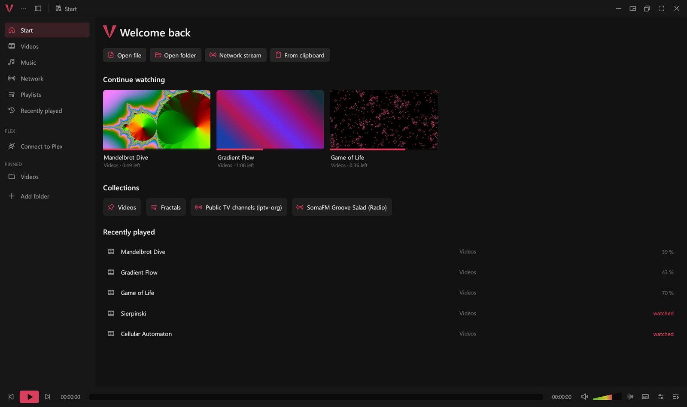
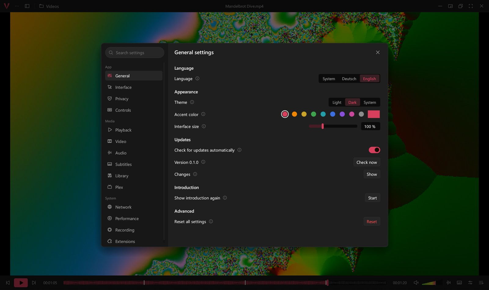
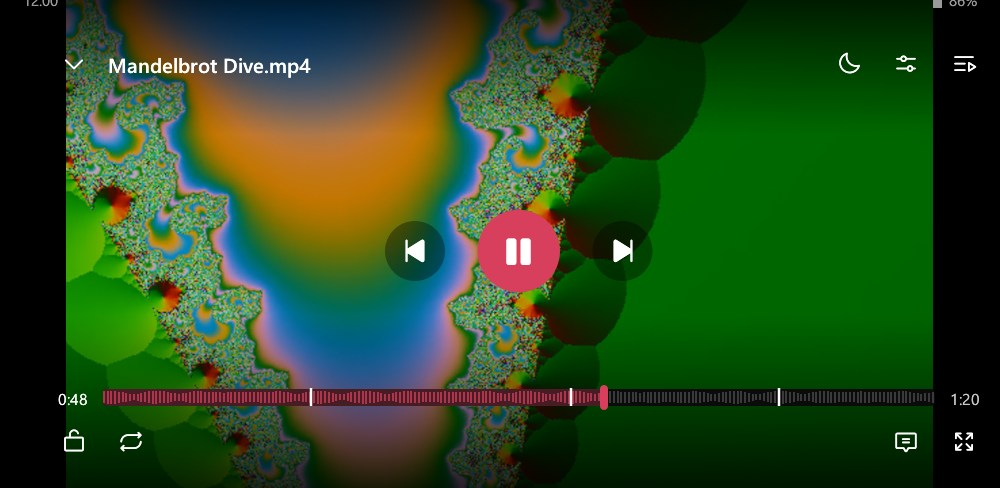
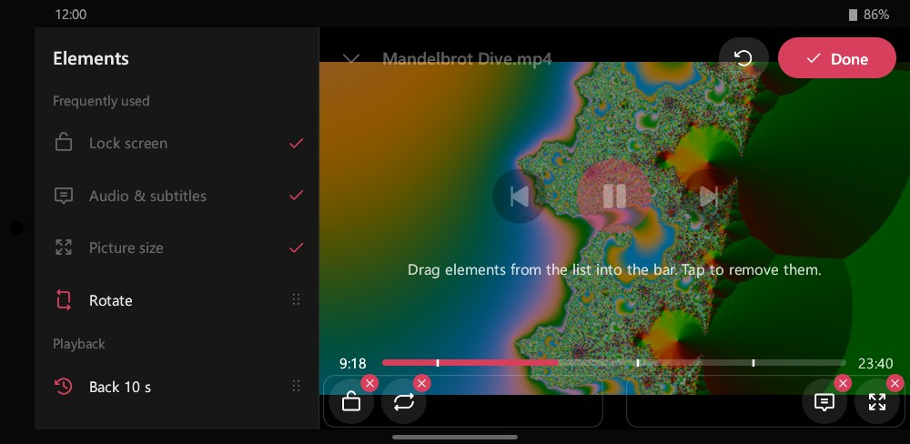
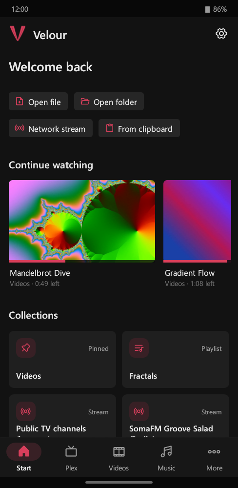

<div align="center">

# Velour

**A calm, fast media player for Windows and Android, built on mpv.**

Thin bars, a thick seek bar, your library right next to the video, and Plex built in.

[Download](https://github.com/BotAwesome/velour/releases/latest) ·
[Changelog](CHANGELOG.md) ·
[Build from source](#build-from-source)


</div>

## Features

**Playback**
- Plays nearly every video and audio format via [mpv](https://mpv.io), with hardware decoding
- Thick, easy-to-hit seek bar with preview thumbnails, chapter marks and an optional waveform
- The seek bar snaps to chapter starts, and stops doing so for a chapter you keep skipping past
- Resume where you left off, playback speed, A-B repeat, sleep timer, picture-in-picture
- 10-band equalizer with presets, loudness normalization, night mode and video color presets
- Subtitles: auto-load, add from file, and a style editor for font, size, colors and position

**Library**
- Start page with "Continue watching", recently played, collections and pinned folders
- Video and music folders, playlists, network streams and IPTV lists
- Plex: sign in, browse your libraries, search, play and keep watch progress in sync

**Android**
- Touch layout: swipe for volume and brightness, double-tap the edges to skip
- A player bar you rearrange live with drag and drop
- Screen lock, video scaling modes, Plex libraries in a swipe-in drawer

**Everywhere**
- German and English, light and dark theme, your own accent color
- Updates itself from GitHub releases and shows what changed before installing

## Screenshots

**Windows:** start page and settings

<p>
  
  
</p>

**Android:** player, the live player bar editor and the start page

<p>
  
  
</p>
<p>
  
</p>

The videos in these screenshots are generated with FFmpeg (fractals and cellular automata).

## Install

Get the files from the [latest release](https://github.com/BotAwesome/velour/releases/latest).

- **Windows 10/11 (64-bit):** run `Velour-Setup-<version>.exe`. It installs for your user only
  (no admin rights) and brings FFmpeg along. Uninstall from *Settings → Apps*.
- **Android 8 or newer (arm64):** open `Velour-<version>-arm64.apk` on the phone and allow
  installing apps from that source when Android asks.

Velour checks for new releases once a day (you can turn that off in *Settings → General*)
and asks before it installs anything.

## Build from source

You need a current stable [Rust](https://rustup.rs) (edition 2024).

### Windows

1. Put `libmpv-2.dll` into `lib/`, e.g. from an `mpv-dev-x86_64` package of
   [shinchiro/mpv-winbuild-cmake](https://github.com/shinchiro/mpv-winbuild-cmake/releases).
2. Run it:

   ```bash
   cargo run --release
   ```

   `cargo run -- --phone` opens the phone layout in a window (F9 rotates).

3. Installer: `pwsh installer\build.ps1` builds `dist\Velour-Setup-<version>.exe`
   (needs `ffmpeg.exe` and `ffprobe.exe` on `PATH` or `-FFmpegDir`).

### Android

Needs the Android SDK and NDK and [cargo-ndk](https://github.com/bbqsrc/cargo-ndk):

```bash
rustup target add aarch64-linux-android
cargo install cargo-ndk
pwsh android\build.ps1 -Abi arm64-v8a -Release
```

The APK ends up in `android\app\build\outputs\apk\release\`.

### Releasing

Raise the version in `Cargo.toml`, add a section for it at the top of `CHANGELOG.md`, commit,
then:

```bash
pwsh tools\release.ps1 -Publish
```

It builds the installer and the APK and publishes a GitHub release with the changelog section
as its text. Installed copies of Velour pick it up from there.

## Project layout

| Path | What |
|---|---|
| `src/` | The app (egui), shared by Windows and Android |
| `src/plex/` | Plex sign-in, browsing and playback |
| `setup/` | The installer and uninstaller |
| `android/` | Android project (NativeActivity) and build script |
| `lang/en.json` | English texts (German is the source language) |
| `i18n-macros/` | Compile-time check that every text has a translation |

## Credits

Velour stands on [mpv / libmpv](https://mpv.io), [FFmpeg](https://ffmpeg.org),
[egui](https://github.com/emilk/egui), [Phosphor Icons](https://phosphoricons.com) and
[libmpv-android](https://github.com/jarnedemeulemeester/libmpv-android).
Velour is not affiliated with or endorsed by Plex Inc.

## License

Velour is free software under the [GNU General Public License v3.0 or later](LICENSE).
The Windows installer and the Android app include mpv and FFmpeg, which come with their
own licenses (listed in the installer's `licenses` folder).
