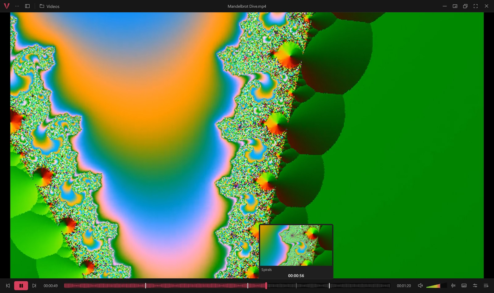
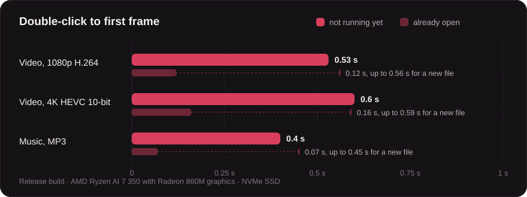
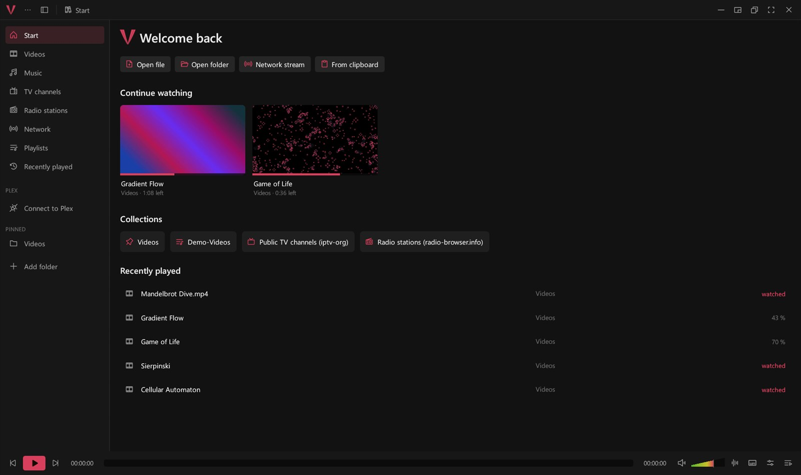
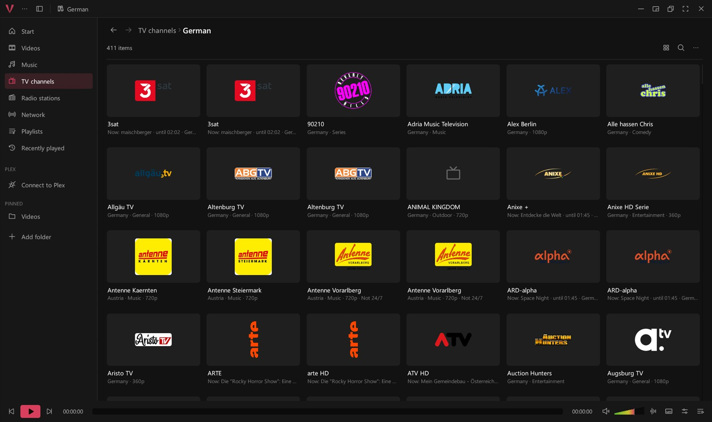
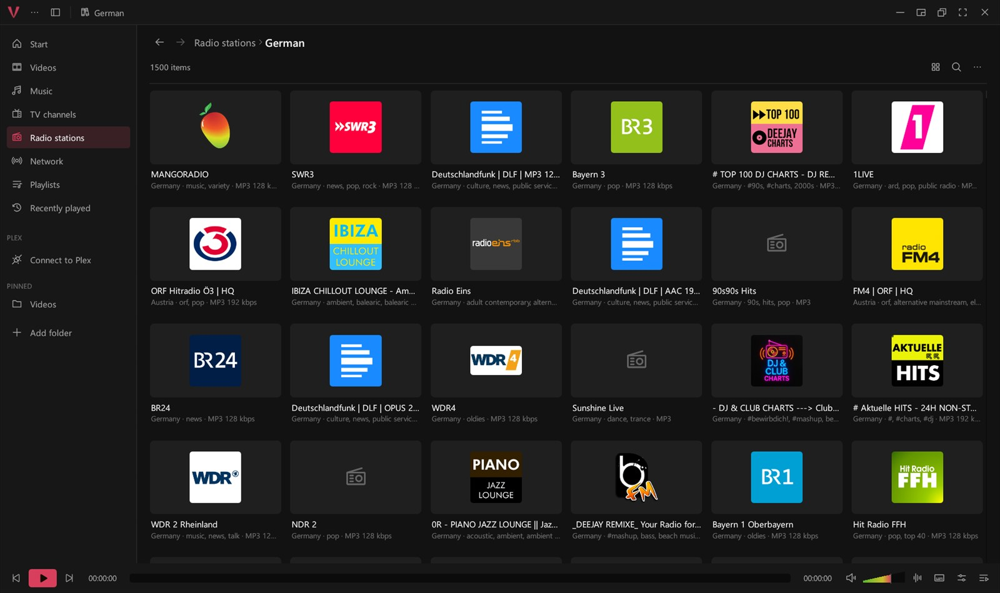
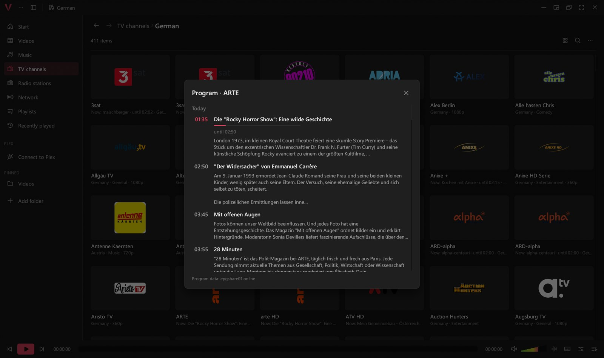
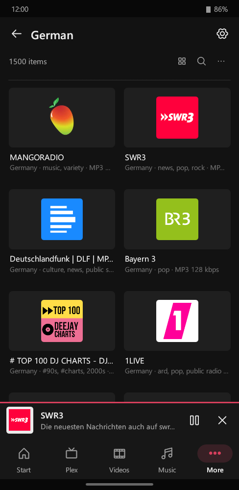
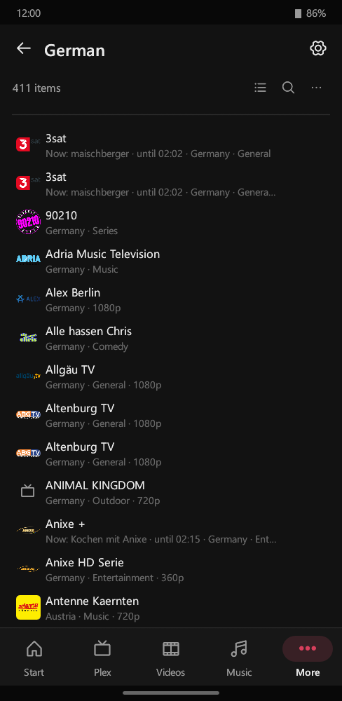

<div align="center">


# Velouna

**A blazing fast media player for Windows, Linux and Android, built on mpv.**

Picture in half a second, even from a cold start. Your files, Plex, Jellyfin, Emby,
free TV and radio – in one player.

**No telemetry, no tracking.** Crash reports are sent only if you click *Send* – without any identifier.

[](https://github.com/BotAwesome/velouna/releases/latest)
[](LICENSE)


[**Download**](https://github.com/BotAwesome/velouna/releases/latest) ·
[Website](https://botawesome.github.io/velouna/) ·
[Changelog](CHANGELOG.md) ·
[Build from source](#build-from-source)



</div>

<a name="blazing-fast"></a>




No splash screen and no library scan before playback: the file goes to mpv the moment
the window can show a picture, decoded on the graphics card. Opening another file hands
it to the window that is already open instead of starting a second Velouna. The very first
start after booting takes a little longer while the system reads Velouna from disk.

<a name="highlights"></a>


<table>
<tr>
<td width="50%" valign="top">

<br>
**Playback**<br>
Nearly every video and audio format via [mpv](https://mpv.io), with hardware decoding. A
thick seek bar with preview thumbnails, chapter marks and an optional waveform. HDR
videos play in real HDR when Windows HDR is on. Resume, speed, A-B repeat, sleep timer,
picture-in-picture, a 10-band equalizer and a subtitle style editor.

</td>
<td width="50%" valign="top">

<br>
**Library**<br>
A start page with *Continue watching*, your video and music folders, playlists, pinned
folders and network streams. Music plays on in the library with a mini player, so you
can keep browsing.

</td>
</tr>
<tr>
<td valign="top">

<br>
**Live TV and radio**<br>
Thousands of free TV channels ([iptv-org](https://github.com/iptv-org/iptv)) and radio
stations ([Radio Browser](https://www.radio-browser.info)), sorted by language, with
logos, search and favorites. TV shows what's on now and a day's program guide; radio
shows the song that's playing.

</td>
<td valign="top">

<br>
**Plex, Jellyfin and Emby**<br>
Sign in to Plex, or connect a Jellyfin or Emby server with its address, user name and
password. Browse libraries, collections and playlists, search, and play – watch progress
stays in sync with your server.

</td>
</tr>
<tr>
<td valign="top">

<br>
**Music you can see**<br>
Visualizers that know the whole song: Velouna analyses beats, kicks, build-ups and drops
once, and the picture follows them. The Velounizer brings Ink, Aurora and Contour. With
the visualizer off, songs get a now-playing page with cover and queue.

</td>
<td valign="top">

<br>
**Plugins**<br>
Install plugins from the built-in catalog or from any repo by its link. Repos are
signed. Write your own visualizers and Lua plugins, no compiler needed:
[examples and docs](https://github.com/BotAwesome/velouna-example-plugins).

</td>
</tr>
<tr>
<td valign="top">

<br>
**Android**<br>
A touch layout: swipe for volume and brightness, double-tap the edges to skip, lock the
screen, and rearrange the player bar live with drag and drop.

</td>
<td valign="top">

<br>
**Everywhere**<br>
German and English, light and dark theme, your own accent color. On Windows: media keys
and the volume overlay, buttons and progress in the taskbar, recent files in the jump
list. Velouna updates itself from GitHub releases and shows what changed before it
installs anything.

</td>
</tr>
</table>

<a name="screenshots"></a>


More on the [website](https://botawesome.github.io/velouna/#screenshots).

<table>
<tr>
<td width="50%"></td>
<td width="50%"></td>
</tr>
<tr>
<td></td>
<td></td>
</tr>
</table>

<p align="center">
  
  
  
</p>

The videos in these screenshots are generated with FFmpeg.

<a name="install"></a>


Get the files from the [latest release](https://github.com/BotAwesome/velouna/releases/latest).

| | |
|---|---|
| **Windows 10/11 (64-bit)** | Run `Velouna-Setup-<version>.exe`. It installs for your user only (no admin rights) and brings FFmpeg along. Uninstall from *Settings → Apps*. |
| **Linux (x86_64)** – Pop!_OS, Ubuntu 22.04+, Debian 12, Mint … | `sudo apt install ./velouna_<version>_amd64.deb` installs to `/opt/velouna`. Other distributions (glibc 2.35+): unpack `velouna-<version>-linux-x86_64.tar.gz` and run `./install.sh` (no root). Both bring mpv, FFmpeg and yt-dlp along. |
| **Android 8 or newer (arm64)** | Open `Velouna-<version>-arm64.apk` on the phone and allow installing apps from that source when Android asks. |

Velouna looks for a new release once a day (you can turn that off in *Settings → General*)
and asks before it installs anything.

<a name="build-from-source"></a>


You need a current stable [Rust](https://rustup.rs) (edition 2024).

### Windows

1. Put `libmpv-2.dll` into `lib/`, e.g. from an `mpv-dev-x86_64` package of
   [shinchiro/mpv-winbuild-cmake](https://github.com/shinchiro/mpv-winbuild-cmake/releases).
2. Run it:

   ```bash
   cargo run --release
   ```

   `cargo run -- --phone` opens the phone layout in a window (F9 rotates).

3. Installer: `pwsh installer\build.ps1` builds `dist\Velouna-Setup-<version>.exe`
   (needs `ffmpeg.exe` and `ffprobe.exe` on `PATH` or `-FFmpegDir`).

### Linux

Built on Windows as a cross-compile with [cargo-zigbuild](https://github.com/rust-cross/cargo-zigbuild)
(zig from `pip install ziglang`, its folder on `PATH`):

```bash
cargo zigbuild --release -p velouna --target x86_64-unknown-linux-gnu.2.31
python tools/linux/package.py
```

The packages bring their own mpv, FFmpeg and yt-dlp from `dist/linux-runtime`, which
`tools/linux/build-libs.sh` builds in an Ubuntu 22.04 container
(`docker run --rm -v "$PWD/out:/out" -v "$PWD/build-libs.sh:/build-libs.sh:ro" ubuntu:22.04 bash /build-libs.sh`).
`package.py` writes `dist/velouna_<version>_amd64.deb` and `dist/velouna-<version>-linux-x86_64.tar.gz`.

### Android

Needs the Android SDK and NDK and [cargo-ndk](https://github.com/bbqsrc/cargo-ndk):

```bash
rustup target add aarch64-linux-android
cargo install cargo-ndk
pwsh android\build.ps1 -Abi arm64-v8a -Release
```

The APK ends up in `android\app\build\outputs\apk\release\`.

### Releasing

Raise the version in `Cargo.toml`, add a section for it at the top of `CHANGELOG.md`, commit,
then run `pwsh tools\release.ps1 -Publish`. It builds the installer, the APK and the Linux packages and publishes
a GitHub release with the changelog section as its text. Installed copies of Velouna pick it
up from there.

<a name="project-layout"></a>


| Path | What |
|---|---|
| `src/` | The app (egui), shared by Windows, Linux and Android |
| `src/plex/` | Plex, Jellyfin and Emby: sign-in, browsing and playback |
| `src/platform/` | Windows integration (media keys, taskbar, jump list, HDR output) |
| `src/iptv.rs`, `src/epg.rs`, `src/radio.rs` | Public TV, program guide and radio directory |
| `setup/` | The installer and uninstaller |
| `android/` | Android project (NativeActivity) and build script |
| `tools/linux/` | Linux packages (.deb, .tar.gz) and the build of their mpv/FFmpeg runtime |
| `lang/en.json` | English texts (German is the source language) |
| `i18n-macros/` | Compile-time check that every text has a translation |
| `docs/` | The website (GitHub Pages) and screenshots |

<a name="credits"></a>


Velouna stands on [mpv / libmpv](https://mpv.io), [FFmpeg](https://ffmpeg.org),
[egui](https://github.com/emilk/egui), [Phosphor Icons](https://phosphoricons.com) and
[libmpv-android](https://github.com/jarnedemeulemeester/libmpv-android).
TV channels come from [iptv-org](https://github.com/iptv-org/iptv), program guides from
[epgshare01](https://epgshare01.online) and radio stations from
[Radio Browser](https://www.radio-browser.info); Velouna does not host any streams.
Velouna is not affiliated with or endorsed by Plex Inc.

<a name="license"></a>


Velouna is free software under the [GNU General Public License v3.0 or later](LICENSE).
The Windows installer, the Linux packages and the Android app include mpv and FFmpeg,
which come with their own licenses (listed in the installer's `licenses` folder and in
`/usr/share/doc/velouna/copyright` of the Linux package).
